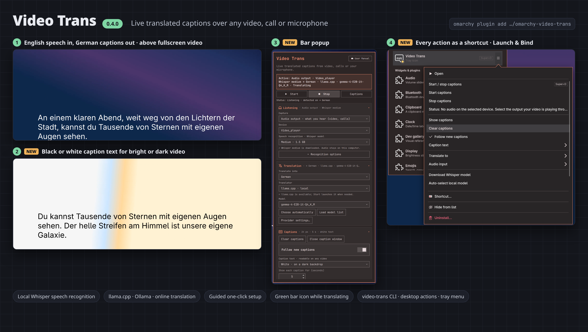

# Video Trans

Live translated captions for Omarchy, from **audio output or an explicitly selected microphone**. Click the bar icon to open a native Omarchy popup using the standard shell controls and layout. Translated text appears in an **independent, resizable floating caption window**. Whisper is the first speech-provider choice; llama.cpp, Ollama or an OpenAI-compatible online API translates the recognized text. German is the default target.



The preview shows real captions from version 0.4.0: an English narration synthesized locally (Kokoro) over a generated test video, translated to German by Whisper and a local llama.cpp model.

**[User manual](MANUAL.md)** · **[Marketplace description](MARKETPLACE.md)** · **[MIT license](LICENSE)**

## Features

- Local multilingual Whisper detects the spoken language automatically, including after a language change. You can override it with a language code.
- Choose **Audio output** or **Microphone**. Output mode only enumerates sink monitors; microphone mode only enumerates non-monitor sources. No microphone or output fallback.
- FFmpeg speech-band filtering and optional adaptive FFT noise suppression, followed by Silero voice activity detection and Whisper confidence checks. These reduce false captions; they cannot completely separate speech from music or other voices.
- Separate speech-model and translation-model selectors. Whisper runs on CPU with int8, leaving GPU memory for your translator.
- Local llama.cpp router and Ollama support automatic service startup, model discovery and model cleanup. **Choose automatically** (in Translation) considers the target language, multilingual model family and model size, excluding speech-synthesis, embedding and coding-only models. This is an editable heuristic suggestion, not a quality benchmark.
- Online endpoint, model and masked API-key / bearer-token configuration. Compatible with the `/v1/models` and `/v1/chat/completions` protocols, rather than every provider's proprietary API.
- A native Omarchy popup for settings and translation controls, independent of the caption window. Its popup uses a local snapshot of the original Omarchy controls, with fixed typography and spacing across themes, with the native shell palette and borders.
- A resizable floating caption window with adjustable font size, background transparency and border thickness. These appearance controls affect **only the overlay**, never the native widget/panel. Overlay background, text and border colors follow the active Omarchy theme; The background is fully transparent with a 1 px border by default. The border appears when the overlay opens or gains focus, and becomes invisible on focus loss without shifting the captions; both can be adjusted, and −1 uses the theme's popup settings. Text stays opaque as background transparency changes. Theme changes are picked up while the window is open. Each caption stays visible for 5 seconds by default, then expires independently. Adjust **Caption duration (seconds)** from 1 to 120 seconds and **Caption font size** in the main plugin controls, including while translating. The overlay can shrink to approximately three lines at the selected font size. Disable **Follow new captions** in the plugin panel to read older captions without being scrolled away.
- Stop closes the overlay immediately, releases the speech worker and owned resources, then exits the GUI.

## Install

```bash
omarchy plugin add https://github.com/uBruckhaus/omarchy-video-trans.git --enable
```

Then click the **Video Trans** bar icon. The popup shows a **Not ready yet** card that names the one next step and a button that does it:

1. **Set up now** installs missing system packages (`ffmpeg`, `libpulse`, `quickshell`, `uv`; you confirm a password prompt) and an isolated Python 3.12 runtime with pinned dependencies under `~/.local/share/video-trans/runtime`, plus the `video-trans` command and desktop actions.
2. **Use <device>** chooses the playback device to caption (the default output is offered first; **Other options** has the others and the microphone).
3. **Download Whisper …** caches the selected speech model once.
4. If no local translator is found, the card offers the installed alternative (llama.cpp or Ollama) or **Connect an online provider…**.
5. **Choose a model automatically** picks an installed translation model for the target language.

When every step is done the card disappears and **✓ Ready** appears. Setup from a terminal works too: `bash ~/.config/omarchy/plugins/ubruckhaus.video-trans/setup.sh` (packages installed beforehand with `omarchy pkg add ffmpeg libpulse uv`). Setup never starts capture or a translation provider.

The Whisper model (Tiny, Base, Small, Medium, Large v3 or Turbo) is chosen in **Listening**. First **Start** also downloads it if needed; Stop or Close cancels a download. A filesystem path to an existing faster-whisper / CTranslate2 model also works. Models such as `tiny.en` are English-only; choose a multilingual model for automatic language detection.

On Omarchy/Wayland the independent caption surface uses Quickshell's **overlay layer**, so it remains above fullscreen video. It belongs to the workspace where it opens: switching workspaces hides it, returning shows the same captions, and capture continues in the background. No Hyprland window rule is required. Drag anywhere inside it with the plain left mouse button to move it (Shift + drag selects text) and its bottom-right handle to resize it; the handle and border appear only while the pointer is over the captions. Scroll the mouse wheel to read earlier captions. ■ Stop and Close caption window in the popup close it and release owned resources.

## Use

The popup follows Screen Narrator's layout: a summary of the active setup, **▶ Start**, **■ Stop** and **Captions** buttons, the next-step card while something is missing, and three collapsible groups:

- **Listening** — capture **Audio output** (what you hear: video, calls) or **Microphone**, the device, and the Whisper model with its download. **Recognition options** holds the spoken-language override, noise suppression and chunk length. Audio output captures every application playing through that device; mute unrelated audio.
- **Translation** — target language, translator (llama.cpp, Ollama or Online) and model. **Choose automatically** considers the target language, multilingual model family and model size, excluding speech-synthesis, embedding and coding-only models; it is a heuristic, not a benchmark, and never downloads models. **Provider settings…** opens a subpage for the server address, model ID and API key (paste with Ctrl+V; Backspace returns).
- **Captions** — clear or close the caption window, follow new captions, **Caption text** (Omarchy theme, white, or black for bright video; the backdrop takes the opposite colour), display duration, font size (12–64) and **Caption window appearance** (transparency, border, history; `−1` uses the Omarchy theme default).

**▶ Start** opens the caption window and begins translation; if a requirement fails, a startup check lists target language, audio capture, Whisper, provider and model with ✓ / ✕. **Captions** opens the window without capturing. The bar icon turns the theme's green while captions run; right-click it to start or stop without opening the popup. Closing the popup leaves captions running; **■ Stop** closes the window, releases owned models and services and exits the controller. Settings save immediately, also while Video Trans is off.

Audio is processed in overlapping 5-second chunks by default. Larger chunks improve sentence context but increase latency. If inference cannot keep up, a bounded audio queue drops older chunks and reports this in the status line. Text is not synchronized to a delayed video. Source-language detection can be uncertain for short/noisy speech; select a source-language override when needed.

## Shortcuts and actions

Setup adds the `video-trans` command and a **Video Trans** application entry whose
desktop actions are **Start / stop captions**, **Start captions**, **Stop captions**,
**Show captions**, **Clear captions**, **Follow new captions on / off**, **Capture audio
output**, **Capture microphone**, **Download Whisper model**, **Auto-select local model**
and **Refresh models**. In Launch & Bind, open **Apps → Video Trans → Shortcuts**, choose
the action and assign your key. The default application action opens the bar popup.
If you set Video Trans up before these actions existed, press **Add shortcut actions** in the popup's **Captions** group (or run `bash install-shortcuts.sh` in the plugin folder). Setup does not assign a key automatically, and it leaves an existing `video-trans`
command or desktop entry that it did not create untouched.

The same actions work from a terminal:

```bash
video-trans toggle | start | stop | show | clear
video-trans follow [on|off|toggle]
video-trans target French          # one of the popup's target languages
video-trans input Microphone       # or "Audio output"
video-trans download | cancel-download | models | suggest
video-trans settings               # open the bar popup
video-trans status                 # current state as JSON
```

`stop`, `clear` and `status` never start Video Trans. Target language and input
changes are saved directly while it is off, and refused while captions are running.

Video Trans also shows a tray icon whenever its bar widget is loaded, like Screen Narrator. Launch & Bind lists it under **Plugins → Running in the bar**; its menu has these entries plus **Translate to** and **Audio input** submenus and **Settings…**, and each entry can be clicked or bound with **Shortcut…**. The icon fills with the theme's green while captions run. The tray is a small separate process (`tray.py`, started by the bar widget); its entries run `video-trans <action>`, so the caption controller and models still load only when needed. Entry labels stay fixed in every state so saved shortcuts keep working.

## Providers and authentication

### llama.cpp

Default endpoint: `http://127.0.0.1:8080`. Requires a configured **user** service named `llama-server.service` and a router exposing model discovery, chat completions and `/models/unload`. Video Trans uses your existing installation and model presets; it does not install llama.cpp or download translation models.

If the endpoint is already reachable, no service is started. Otherwise Video Trans starts the user service. On Stop or Close it unloads models it used that were not already loaded at discovery, then stops a service it started. Pre-existing loaded models and pre-existing services are retained. An older single-model server lacking router status/unload is treated as shared and is not forcibly stopped.

### Ollama

Default endpoint: `http://127.0.0.1:11434`. If unreachable, Video Trans tries the `ollama.service` user unit, then launches its own `ollama serve` child if no user unit is available. Install Ollama and pull models yourself first. Video Trans never starts or stops a system-wide Ollama service.

Models newly used by Video Trans are unloaded using `keep_alive: 0`. Pre-existing loaded models are retained. An owned Ollama process/service is stopped. A remote local-provider endpoint is used directly and no local service is started.

### Online

Enter an OpenAI-compatible HTTPS base URL (with or without `/v1`), a model and an **API key or existing bearer access token**. The key is sent as `Authorization: Bearer …`. If your provider does not expose model discovery, enter the model manually and click Start.

Browser OAuth sign-in, subscription-login scraping, provider-specific APIs and automatic token refresh are not implemented. Use a provider-issued API key or a valid access token from an authentication flow you manage. HTTP with credentials is accepted only for loopback endpoints; use HTTPS remotely.

Whisper still processes audio locally. **Only recognized text is sent to the selected translation endpoint**, including for online providers. Online API charges are governed by your provider account. No translation requests occur until Start.

## Resource lifecycle and local data

- The shell widget loads no AI model. Simply opening the native popup reads settings/device metadata without starting the overlay process. Changing settings or requesting an action starts a separate hidden caption controller as needed; refreshing models may start the selected local service, but does not itself request inference. Closing a popup without an open overlay releases that controller. A private owner-only local socket connects the native panel and caption process; token values are never returned in panel status responses.
- Stop hides the overlay immediately, terminates capture, completes any in-flight inference request, unloads owned translation models, stops owned services and exits the speech worker process. Close hides the window immediately and waits asynchronously for this cleanup before exiting.
- Model downloads run as cancellable children. Ordinary provider requests have a 60-second read timeout; service shutdown may take up to 70 seconds. Stop/Close may take time while an inference request finishes.
- The GUI process releases its memory on exit. Previously loaded/shared translation models remain loaded intentionally. There is no cross-application model lease protocol: another application using a model newly loaded by Video Trans can be affected by that model's unload; use a dedicated endpoint when sharing concurrent workloads.
- Forced process kills, machine power loss and a provider refusing its unload API can prevent graceful cleanup. The status line reports cleanup errors when available.

| Data | Default location |
| --- | --- |
| Preferences | `~/.config/video-trans/settings.json` |
| Optional saved API keys/tokens | `~/.config/video-trans/credentials.json` (0600) |
| Isolated Python runtime | `~/.local/share/video-trans/runtime/` |
| Whisper models | Hugging Face cache, usually `~/.cache/huggingface/hub/` |
| Captions/audio | In memory only; not saved to disk |

XDG config/data paths are respected. Credentials are stored only if **Save token locally** is selected; the file is owner-only plaintext, not an encrypted keychain. Provider tokens never go into the repository or settings file. No telemetry. Credentials and preferences remain after removing the plugin.

## Update and remove

Stop translation before updating or removing the plugin.

```bash
omarchy plugin update ubruckhaus.video-trans
bash ~/.config/omarchy/plugins/ubruckhaus.video-trans/setup.sh
```

Rerun setup after updates to synchronize the isolated runtime with the pinned dependencies.

```bash
omarchy plugin remove ubruckhaus.video-trans
```

Removal deletes the plugin checkout and bar integration. It retains preferences, saved credentials, the isolated runtime and cached Whisper models. See the [manual](MANUAL.md#remove-and-clean-up) for optional cleanup. Removal leaves the `video-trans` command and desktop entry; delete `~/.local/bin/video-trans` and `~/.local/share/applications/video-trans.desktop` if you no longer want them. Setup never edits Hyprland bindings or replaces user configuration.

## Development and checks

```bash
bash setup.sh
~/.local/share/video-trans/runtime/bin/python -m unittest discover -s tests -v
omarchy plugin validate .
bash -n setup.sh launch.sh bridge.sh start.sh stop.sh toggle.sh
python3 -m unittest tests.test_readiness tests.test_bridge   # also runs before setup, on the system Python
```

Tests cover device-type isolation, capture filters, provider protocols, ownership cleanup, credential permissions, target-sensitive model suggestions, Omarchy theme defaults, appearance overrides, plain-text caption rendering, retained captions and asynchronous close. They do not require models, audio capture or paid API calls. A full local integration check also passed: playback through a temporary silent sink → noise filtering → Whisper English detection → Gemma German translation → worker/service cleanup. Whisper rejected a synthetic non-speech noise sample. Online and Ollama integration need their respective accounts/installations.

See [MARKETPLACE.md](MARKETPLACE.md) for listing details. MIT licensed. Independent community plugin.

The target-language check validates the selected translation target; it does not benchmark model fluency. Whisper detects the **source** language, independently of the target. English-only speech models require an English source override. For online endpoints without a model-list API, provider/model checks remain pending until the first successful translation verifies them.

Optional desktop check: `QT_QPA_PLATFORM=wayland ~/.local/share/video-trans/runtime/bin/python scripts/smoke_fullscreen.py` verifies fullscreen stacking and workspace visibility with a temporary test window.

Optional shortcut in `~/.config/hypr/bindings.lua` (replaces the stock Clipboard manager binding):

```lua
hl.unbind("SUPER + CTRL + V")
o.bind("SUPER + CTRL + V", "Video Trans: toggle translated captions", { launch = "bash " .. os.getenv("HOME") .. "/.config/omarchy/plugins/ubruckhaus.video-trans/toggle.sh" })
```

Super + Ctrl + V toggles the overlay: opening starts translation; closing stops capture and releases owned resources.

## Popup layout and manual

Click **User Manual** in the popup for built-in guidance. See [MANUAL.md](MANUAL.md) for the full manual. Popup layout stays fixed across desktop themes; colors and borders match the native shell.
